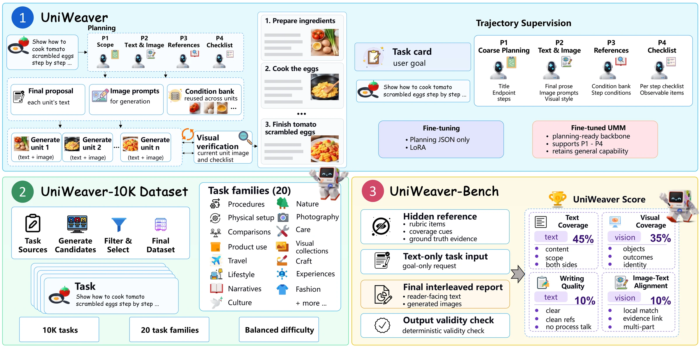

<div align="center">

# UniWeaver: Harnessing Unified Multimodal Models for Interleaved Text-Image Generation

[](https://poscape.github.io/UniWeaver/)
[](https://github.com/Poscape/UniWeaver)
[](https://arxiv.org/abs/2611.13530)
[](https://huggingface.co/datasets/poscape/UniWeaver-Bench)
[](https://huggingface.co/datasets/poscape/UniWeaver-10K)

</div>

---

## 🔥 News

- **2026.11** — Code, [UniWeaver-Bench](https://huggingface.co/datasets/poscape/UniWeaver-Bench),
  and [UniWeaver-10K](https://huggingface.co/datasets/poscape/UniWeaver-10K) released.

## 🌟 Overview

UniWeaver is a model-agnostic harness that plans a request into typed text-image units,
generates each unit, and checks every generated image against observable visual evidence.

- **Four-stage harness.** `P1` fixes task scope and endpoint, `P2` separates
  reader-facing prose from image prompts, `P3` routes reusable references, and
  `P4` writes observable visual checks. Units that fail a check are regenerated
  within a bounded budget; no backbone parameter changes.
- **Seven backbones.** Adapters for BAGEL, OmniGen2, Show-o2, TokenFlow,
  ILLUME+, Janus-Pro, and SEED-X, each able to run the full harness or a
  step-wise minimal baseline.
- **Output-level evaluation.** UniWeaver-Bench scoring with text coverage,
  writing quality, visual coverage, and image-text alignment, judged by three
  models with two calls per criterion.
- **Training and ablations.** LoRA training on constructed trajectories, and
  seven ablation variants with source, model, and checkpoint provenance checks.

<div align="center">
  
</div>

## 🗂️ Repository Layout

```text
UniWeaver/
├── assets/                # Figure shown in this README
├── harness/
│   ├── core/              # planning, execution, validation, review, persistence
│   ├── baselines/         # UMM adapters and the run_umm.py entrypoint
│   ├── evaluation/        # request preparation, judges, collected inputs
│   ├── sft_prepare_data/  # task pool and trajectory construction
│   ├── sft_train/         # BAGEL LoRA training and corpus preflight
│   ├── ablation/          # seven variants and provenance checks
│   ├── modeling/          # vendored BAGEL source (upstream layout)
│   ├── scripts/           # batch launchers and backend readiness checks
│   ├── tests/             # CPU-only test suite
│   └── NOTICE.md
├── scoring/
│   ├── scripts/score_table.py   # judge verdicts -> result table
│   └── ablation_table.py        # ablation table from the same output
├── requirements.txt
├── LICENSE
└── README.md
```

## 🛠️ Installation

Use Python 3.10 or 3.11 with the CUDA and PyTorch build that matches your GPUs.
Install the backbone's official GPU stack first; this file adds the remaining
Python packages to that same environment.

```bash
python -m pip install -r requirements.txt
```

Backbones and batch outputs are read from `WORK_ROOT`:

```text
$WORK_ROOT/
├── repos/     # upstream backbone repositories
├── models/    # backbone, tokenizer, and VQ weights
└── runs/      # batch outputs, one directory per run
```

`WORK_ROOT` defaults to the ignored `harness/output_run/` tree, so weights
placed there need no environment variable. Set `WORK_ROOT` to use another
parent directory.

## 🚀 Quick Start

Each block starts from the repository root; blocks that use the harness package
change into `harness/` first.

### 1. Construct one trajectory

```bash
cd harness

python baselines/run_umm.py \
  --trajectory-only \
  --planner api \
  --dataset single \
  --benchmark-file /path/to/benchmark.json \
  --task-key TASK_ID \
  --output-dir /path/to/trajectory.json
```

The API planner defaults to `deepseek-v4-pro`; supply the credential through
`UMM_API_KEY` (or `--key`) and the endpoint through `UMM_API_BASE_URL`
(or `--base-url`).

### 2. Generate one task

```bash
cd harness

python baselines/run_umm.py \
  --execution online \
  --protocol uniweaver \
  --dataset single \
  --backend bagel \
  --model-path /path/to/BAGEL-7B-MoT \
  --benchmark-file /path/to/benchmark.json \
  --task-key TASK_ID \
  --output-dir /path/to/output
```

Use `--protocol minimal` for the step-wise baseline and `--no-review-retry` to
disable checklist review. `python baselines/run_umm.py --help` lists every
backend option.

### 3. Run the benchmark batch

```bash
cd harness

MODE=bench-uniweaver \
BENCHMARK_FILE=/path/to/benchmark.json \
bash scripts/run_8gpu.sh
```

`MODE=bench-minimal` runs the baseline and `MODE=bench-both` runs both.
`RESUME=1` continues a compatible batch. Set `BAGEL_SFT_CHECKPOINT` to add a
fine-tuned BAGEL chain next to the base chain.

### 4. Judge and score

Judge configs name the endpoint and credential variables they read; provide
those values at runtime.

```bash
cd harness

RUN_DIR=/path/to/run \
REPORT_JUDGE_CONFIGS="evaluation/config/judge_kimi_k3.json evaluation/config/judge_deepseek_v4_1_flash.json evaluation/config/judge_glm_5_3_flash.json" \
bash scripts/eval_run.sh
```

The launcher prepares the scoring packets, calls each judge twice per
criterion, collects the four scoring inputs, and writes the result table.
Because scoring reads saved records, a table can be rebuilt without calling an
API again.

### 5. Train with LoRA

The launcher uses `harness/sft_train/configs/lora_full_native40k_lr5e-5.json`:
LoRA on the BAGEL understanding decoder, rank 32, alpha 64, dropout 0.05,
learning rate `5e-5`, 40,000 steps over two epochs, maximum sequence length
4096, two samples packed per step.

```bash
BENCHMARK_FILE=/path/to/benchmark.json \
BAGEL_PYTHON=/path/to/python \
bash harness/sft_train/run_sft.sh /path/to/trajectories /path/to/output
```

`BENCHMARK_FILE` is the same matrix used for evaluation; preprocessing screens
the training corpus against it. Use `--resume` to continue a compatible run and
`--config CONFIG.json` to select another configuration. The trainer writes
`model.pt` with the LoRA delta merged into the base weights.

### 6. Run the ablations

```bash
cd harness

FORMAL_UNIWEAVER_ROOT=/path/to/full-bagel-run \
BENCHMARK_FILE=/path/to/benchmark.json \
bash ablation/run_ablation_8gpu.sh
```

Set `BAGEL_SFT_CHECKPOINT` only when that run itself loaded an SFT checkpoint.

## 📦 Data

UniWeaver-Bench is released on
[Hugging Face](https://huggingface.co/datasets/poscape/UniWeaver-Bench). The
harness looks for `bench.json` at the path below; download it from that page and
place it there, or point `BENCHMARK_FILE` at your copy wherever it sits:

```text
harness/datasets/benchmarks/uniweaver_bench/bench.json
```

Each entry carries a task id, the user prompt, family, difficulty, and an
evaluation reference. A run copies the file into its own directory, and scoring
reads that copy as the roster of task ids the run was expected to contain.

UniWeaver-10K is released on
[Hugging Face](https://huggingface.co/datasets/poscape/UniWeaver-10K). Its
trajectories follow the contracts in `harness/core/`: four stage blocks per
task, in the same shape the harness consumes at inference time.

The task pool itself is built with `sft_prepare_data/build_task_pool.py`, which
generates candidates, filters and deduplicates them, then selects a stratified
set per family. `sft_prepare_data/construct_task_pool.py --task-pool POOL
--output-dir DIR` expands the pool into trajectories and skips finished task
files with `--resume`. Both scripts list every option under `--help`.

## 📏 Scoring

`scoring/scripts/score_table.py` turns judge verdicts into the result table. It
reads four collected inputs:

| Input | Content |
|---|---|
| `tasks.jsonl` | task id, family, gate status |
| `criteria.jsonl` | criterion id, metric, weight |
| `judgments.jsonl` | three judges, two passes each |
| `targets.tsv` | model id, display name, order |

```bash
python scoring/scripts/score_table.py \
  --inputs /path/to/inputs \
  --targets /path/to/targets.tsv \
  --out-dir /path/to/out \
  --min-repeats 2
```

Collect one run into a shared input directory with:

```bash
cd harness

python evaluation/run_eval.py collect-inputs \
  --run-dir /path/to/run \
  --run run-name --source bagel \
  --object-id bagel --display-name BAGEL \
  --out-dir /path/to/inputs
```

Collection replaces only the named object, so repeated runs accumulate into one
`judgments.jsonl` and one `targets.tsv`.

The command writes `main_table.tsv` into `--out-dir`, scoring the gate-passing
tasks: a criterion whose three judge medians span more than one tier scores
`0`, and each family is weighted by `sqrt(gate pass rate)`.

Render the ablation table from that same output, using the object id or display
name of the full run:

```bash
python scoring/ablation_table.py /path/to/out/main_table.tsv --full-object uw_bagel
```

## 🧪 Tests

```bash
cd harness
python -m pytest -q tests
```

## 🙏 Acknowledgements

We thank the authors and contributors of BAGEL, Qwen2, SigLIP, and
Transformers, whose open-source code supports this release.

The BAGEL model source is a vendored upstream dependency under
`harness/modeling/`, kept in its upstream `modeling/` layout: `bagel/`,
`qwen2/`, and `siglip/` are sibling modules, and `bagel/qwen2_navit.py` and
`bagel/siglip_navit.py` import the other two directly.

The other backbones are not vendored. Their repositories, weights, and licenses
are supplied through `WORK_ROOT/repos` and `WORK_ROOT/models`.

## 📄 License

See `LICENSE` and `harness/NOTICE.md`. Third-party backbones and vendored model
files retain their own licenses and usage terms.

## 🔗 Citation

```bibtex
@article{chen2026uniweaver,
  title   = {UniWeaver: Harnessing Unified Multimodal
             Models for Interleaved Text-Image Generation},
  author  = {Hongxu Chen and Zixuan Zhong and Donghao Zhou
             and Haodong Li and Xiaomin Yu and Tianhao Li
             and Shiyao Yu and Zhongwei Wan and Pheng-Ann Heng},
  year    = {2026},
  note    = {Project page}
}
```
